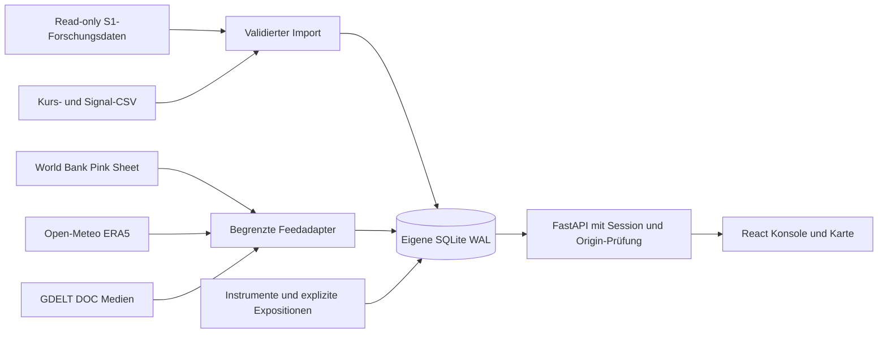

# Architektur

## Grenzen und Ownership

`backend/securities_eye/store.py` verwaltet Schema, Transaktionen, Imports und lesende Abfragen. `context.py` enthält den Instrumentkatalog und feste Provideradapter. `app.py` stellt die API bereit. `cli.py` bietet Import, Abruf und SQLite-Onlinebackup. Die React-Komponenten trennen Markt, Inspector, Chart, Datenbetrieb und Treiberkarte.

Das System ist **single tenant**. Ein gemeinsam verwalteter Zugangsschlüssel wird serverseitig genutzt, nach erfolgreicher Anmeldung folgt ein HMAC-signiertes HttpOnly-SameSite-Strict-Cookie mit acht Stunden Gültigkeit. Keine Tokens in localStorage. Änderungen benötigen den exakt konfigurierten Origin; unbekannte Hosts werden abgewiesen. Docker führt einen Worker aus, da der Login-Limiter pro Prozess lebt. Ein vorgeschaltetes Gateway sollte für öffentliche Zugriffe zusätzliche Rate-Limits bereitstellen.

Alle fachlichen Daten, Watchlists, Importprotokolle und Feed-Zustände liegen in SQLite. Initialisierung ist idempotent; `schema_version=1` umfasst das erste Produkt-Schema. SQLite WAL, 15 Sekunden Busy-Timeout und kurze Transaktionen unterstützen einen Betreiber und mäßige parallele Nutzung. Für große Teams wären individuelle Authentisierung, PostgreSQL, Jobqueue und horizontal skalierbare Verarbeitung erforderlich.

## Datenmodell

| Tabelle | Bedeutung |
| --- | --- |
| `securities` | Symbol, Name, Anlageklasse, Basiswert, Einheit, Währung, Land, Sektor und Referenz-URL |
| `observations` | Kurs oder historische Merkmale, Datum, Quelle, Frequenz und Abruf-/Importzeit; `(symbol,date)` eindeutig |
| `signals` | Modellspezifischer Score mit Quelle; `(symbol,date,layer)` eindeutig |
| `watchlist` | Persistente Beobachtungsliste |
| `imports` | Zeitpunkt, Quelle, Datentyp und Zeilenzahl erfolgreicher Imports |
| `exposures` | Explizite Beziehung von Instrument zu Treiber und Region mit Begründung/Quelle |
| `context_series` | Regionale Zeitreihen und abgeleitete Wetterindikatoren samt Einheit und Abrufzeit |
| `events` | Deduplizierte Medienmeldung pro Treiber mit URL und Erfassungszeit |
| `feed_runs` | Letzter Versuch, letzter Erfolg, Zustand und bereinigte Fehlermeldung |

Importierte Quellen dürfen neu geliefert werden: Kurse/Scores werden anhand ihrer Schlüssel aktualisiert. Das ist eine aktuelle Monitoring-Datenbank, **kein unveränderliches historisches Datenvintage-Archiv**. Für belastbare historische Verfügbarkeit tägliche Snapshots/Backups archivieren.

CSV wird vor dem Schreiben vollständig validiert, der Schreibvorgang ist atomar. Die HTTP-Aufnahme ist auf 10 MiB und 100.000 Zeilen begrenzt. Datenbankimporte verwenden gebundene SQL-Parameter. Externe Antworten haben Größenlimits, Zeitlimits und deaktivierte Redirects; der World-Bank-Workbook-Link wird ausschließlich aus einem festen offiziellen Ursprung und mit engem Zielmuster übernommen. Artikel-URLs werden nur verlinkt, nicht serverseitig abgerufen. Oberfläche rendert Fremdtexte über React-Escaping, nicht als HTML.

Feedabrufe laufen explizit über UI/CLI. Ein in SQLite persistiertes 15-Minuten-Fenster begrenzt Wiederholungen. Je Region/Treiber erfolgreiche Aktualisierungen sind eigene Transaktionen; bei Teilausfällen kann eine Region aktueller als eine andere sein. Jede Beobachtung hat daher ihr eigenes Datum und der Gesamtfeed zeigt den Fehler. Historische gültige Daten werden bei Fehlern nicht gelöscht. Ein abgestürzter `running`-Versuch kann nach dem Cooldown erneut gestartet werden.
